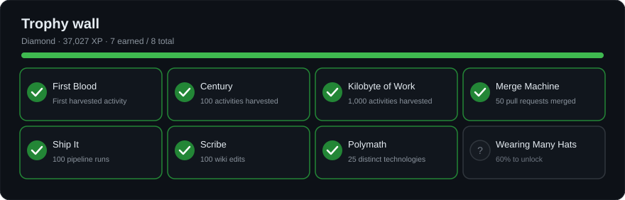

  

## career.git

Most portfolios are a list of claims. Mine is a **river**: a living canvas built
from the real daily activity, widening across the years, with golden pools at
each milestone -- the awards, the promotion, the platform ships. Scroll it.

**[Float the river ->]()**

## Impact in numbers

| XP | Level | Active days | Commits | Pull requests | Reviews | Work items |
|----|-------|-------------|---------|---------------|---------|------------|
| 37,027 | Diamond | 622 | 4,369 | 562 | 195 | 1,047 |

## What I do

- **Cloud &amp; Platforms** — Azure, Azure Container Registry, Azure Blob Storage, Azure Virtual Machines, Azure Bastion, Azure Private Link
- **Virtualization** — OS Provisioning, Hyper-V, VMware ESXi
- **Containers &amp; Orchestration** — Helm, Docker, MicroK8s, Azure Kubernetes Service, Kubernetes

## Trophy wall

  

---

[LinkedIn](https://www.linkedin.com/in/samay-shetty-597191247/) · [Email](mailto:samaymshetty@gmail.com)

Auto-generated from my own verified activity data by
<a href="https://github.com/samayshetty/career-forge">career-forge</a> on 2026-10-20.
Employer-internal identifiers are scrubbed before anything is published.
